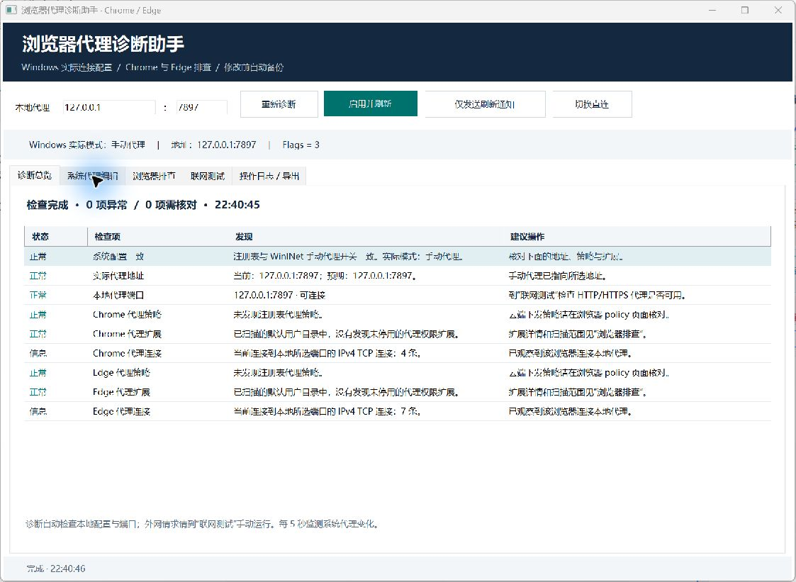

# Browser Proxy Doctor

**浏览器代理诊断助手**：使用 C# / Windows Forms 检查、修复 Windows 系统代理，以及 Chrome、Edge 的代理配置。

适合排查“代理地址已经填好，但浏览器仍在直连”“命令行工具能走代理，Chrome / Edge 却不能”的情况。默认本地代理为 `127.0.0.1:7897`，地址和端口均可修改。



## 下载运行

前往 [Releases](https://github.com/yhm138/browser-proxy-doctor/releases/latest)，下载 `BrowserProxyDoctor-v1.0.0-win-x64.zip`，解压后双击 `BrowserProxyDoctor.exe`。

- Windows 10 / 11，x64，.NET Framework 4.8。
- 将 `BrowserProxyDoctor.exe.config` 与 EXE 放在同一目录。
- 无需管理员权限、Python 或 .NET SDK。
- 先启动 Clash Verge 等本地 HTTP / mixed-port 代理，再使用工具。

## 功能

| 功能 | 检查或修改的内容 |
| --- | --- |
| 诊断总览 | 对比 WinINet 实际配置与注册表开关、地址，检查本地代理端口 |
| 浏览器排查 | Chrome / Edge 的注册表代理策略、代理权限扩展、启动覆盖参数 |
| 浏览器连接 | 按浏览器进程统计连接到所选本地代理端口的活动 IPv4 TCP 连接 |
| 系统代理编辑 | 启用并刷新、仅发送刷新通知、切换直连、修改绕过列表 |
| 浏览器策略修改 | 分别选择跟随系统、固定使用本地代理或清除当前用户代理策略 |
| 联网测试 | 对比指定 HTTP 代理、.NET 系统代理和直连三条路径 |
| 备份与恢复 | 每次修改前自动备份，支持恢复系统配置和当前用户浏览器代理策略 |
| 变化监测与报告 | 窗口打开期间每 5 秒监测系统代理变化，支持导出诊断报告 |

## 常用步骤

1. 确认顶部代理地址与端口，点击 **重新诊断**。
2. 如果实际配置仍是直连，点击 **启用并刷新**。
3. 回到 Chrome / Edge 刷新网页，再次诊断，观察浏览器代理连接。
4. 如果仍有问题，到 **联网测试** 运行三路对比。
5. 在 **浏览器排查** 核对代理策略和扩展，在总览查看启动覆盖参数。

启用代理前会检查本地端口；端口未启动时保留现有系统配置。

## Windows 接口

程序通过 `InternetQueryOptionW` 读取实际的 WinINet 默认 LAN 连接配置，通过 `InternetSetOptionW` 写入配置：

1. `INTERNET_OPTION_PER_CONNECTION_OPTION`（75）：设置连接模式、代理地址、绕过列表和 PAC 地址。
2. `INTERNET_OPTION_SETTINGS_CHANGED`（39）：通知设置变化。
3. `INTERNET_OPTION_REFRESH`（37）：刷新设置。
4. 再次读取并核对写入结果。

“启用并刷新”使用 `PROXY_TYPE_DIRECT | PROXY_TYPE_PROXY`（Flags=3），停用 PAC 与自动检测，保留界面中的绕过列表。“切换直连”使用 Flags=1。

## 浏览器策略与检查范围

代理策略检查覆盖 `HKCU` / `HKLM`、32 / 64 位及 `Recommended`。修改按钮只写所选浏览器的 **HKCU 代理策略白名单**，修改前自动备份。应用策略后，请在浏览器 `policy` 页面重新加载策略，必要时手动重启浏览器。

设置强制代理策略可能使浏览器显示“由组织管理”。机器级 `HKLM` 强制策略由其管理者调整，工具会展示其位置和值。云端下发策略以浏览器 `policy` 页面为准。

扩展检查读取默认用户数据目录下多个用户配置中的代理权限和禁用标记。使用自定义 `--user-data-dir` 时会提示补查。扩展设置由用户在浏览器内调整，可切换为“系统代理”或停用相关代理扩展后重试。

三路联网请求由本工具发出；浏览器验证可用界面中的 Chrome / Edge 按钮打开同一测试网址，再重新诊断观察连接。HTTP 代理测试支持 HTTP / mixed-port，本地仅提供 SOCKS 的端口应改用代理软件的 HTTP 或混合端口。

## 数据与备份

程序配置和备份保存在：

```text
%LOCALAPPDATA%\BrowserProxyDoctor\settings.json
%LOCALAPPDATA%\BrowserProxyDoctor\Backups\
```

关闭窗口后停止监测，系统代理保留最后一次设置。诊断默认只检查本地配置和端口；外网测试由用户手动运行。报告包含代理配置、策略、扩展名称和测试结果，导出后可自行检查再分享。

## 从源码编译

源码位于 [`src`](src)。可用 Visual Studio 打开 [`src/BrowserProxyDoctor.csproj`](src/BrowserProxyDoctor.csproj)，目标为 .NET Framework 4.8 / x64。

也可以使用 Windows 自带的 .NET Framework C# 编译器，无需 NuGet 包：

```powershell
powershell.exe -NoProfile -ExecutionPolicy Bypass -File .\src\build.ps1
```

默认输出到 `src\bin`。`ExecutionPolicy Bypass` 仅作用于这一次 PowerShell 进程。

## 验证

编译后可运行本地自检：

```powershell
$app = (Resolve-Path .\src\bin\BrowserProxyDoctor.exe).Path
$report = Join-Path $env:TEMP 'browser-proxy-doctor-tests.txt'
$process = Start-Process -FilePath $app -ArgumentList @('--self-test', ('"' + $report + '"')) -Wait -PassThru
Get-Content -LiteralPath $report
if ($process.ExitCode -ne 0) { throw 'Self-tests failed' }
```

自检覆盖端点校验、启动参数提取、禁用标记解析、表面开启但实际直连的故障识别、备份序列化、隔离注册表测试键中的策略往返，以及本地模拟 HTTP 代理请求。测试不改动真实浏览器策略或系统代理。

也可生成只读诊断报告：

```powershell
Start-Process -FilePath $app -ArgumentList @('--diagnose-report', ('"' + (Join-Path $env:TEMP 'browser-proxy-doctor-report.txt') + '"')) -Wait
```

## 参考

- [Windows：Setting and Retrieving Internet Options](https://learn.microsoft.com/en-us/windows/win32/wininet/setting-and-retrieving-internet-options)
- [Windows：Option flags](https://learn.microsoft.com/en-us/windows/win32/wininet/option-flags)
- [Microsoft Edge：ProxySettings](https://learn.microsoft.com/en-us/deployedge/microsoft-edge-browser-policies/proxysettings)
- [Chromium：Network Settings](https://www.chromium.org/developers/design-documents/network-settings/)
